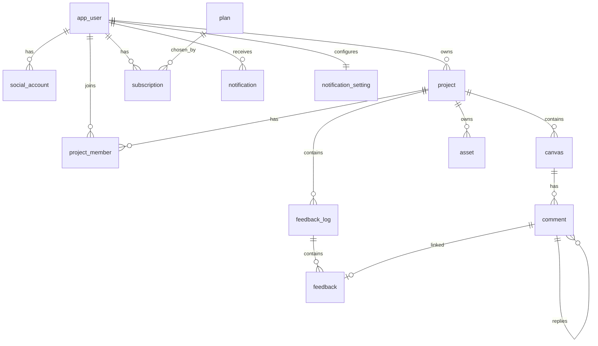

# pinly — DB 테이블 설계 (작업 컨텍스트)

> 이 문서는 Claude Code가 **DB 스키마 / JPA 엔티티 / 마이그레이션을 구현할 때** 기준으로 삼는 스펙이다.
> 저장 위치: `docs/db-schema.md`. 스택: Spring Boot + PostgreSQL. 캔버스 상세는 `docs/canvas-schema.md` 참고.

---

## 0. 이번 작업 목표 (Claude Code가 할 일)

1. 아래 테이블에 대한 **PostgreSQL 마이그레이션** 작성 (Flyway 기준: `src/main/resources/db/migration/V1__init.sql`)
2. 각 테이블에 대응하는 **JPA 엔티티** 작성 (`domain` 패키지)
3. 상태값은 **Java enum + VARCHAR 매핑** (Postgres ENUM 타입은 사용하지 않음 — 마이그레이션 유연성)
4. 완료 기준: 마이그레이션이 로컬 PostgreSQL에서 오류 없이 적용되고, 엔티티가 컴파일된다

**이번 범위 제외**: 실시간 동기화, 결제 PG 연동 실제 처리(구독은 스키마만), Service/Controller 로직.

---

## 1. 설계 원칙

- **PK는 UUID** — `gen_random_uuid()` (PostgreSQL 13+ 내장). 클라이언트 생성 ID도 허용.
- **테이블명 `app_user`** — `user`는 PostgreSQL 예약어라 피한다.
- **타임스탬프는 `TIMESTAMPTZ`**, `created_at` / `updated_at` 기본. `updated_at`은 앱(JPA `@PreUpdate`) 또는 트리거로 갱신.
- **상태·역할은 VARCHAR + CHECK 제약** (또는 앱 레벨 enum 검증). Postgres ENUM 타입 미사용.
- **FK는 `ON DELETE CASCADE` 기본** (자식 데이터 정리). 예외는 각 테이블에 명시.
- **금액은 `NUMERIC`**, 통화·정수 최소단위 고려.
- 소프트 삭제는 MVP에서 미적용(하드 삭제). 필요 시 `deleted_at` 컬럼으로 확장.

---

## 2. ER 다이어그램

---

## 3. 테이블 정의

### 3-1. app_user — 사용자
| 컬럼 | 타입 | 제약 | 설명 |
|---|---|---|---|
| id | UUID | PK, default gen_random_uuid() | |
| email | VARCHAR(255) | UNIQUE, NOT NULL | 로그인 식별자 |
| password_hash | VARCHAR(255) | NULL 허용 | 소셜 전용 계정은 NULL |
| name | VARCHAR(100) | NOT NULL | 표시 이름 |
| created_at | TIMESTAMPTZ | NOT NULL, default now() | |
| updated_at | TIMESTAMPTZ | NOT NULL, default now() | |

### 3-2. social_account — 소셜 로그인 연동
JWT + 소셜 로그인 병행 → 한 사용자가 여러 소셜 연동 가능.
| 컬럼 | 타입 | 제약 | 설명 |
|---|---|---|---|
| id | UUID | PK | |
| user_id | UUID | FK → app_user(id), NOT NULL | |
| provider | VARCHAR(20) | NOT NULL | `GOOGLE` / `KAKAO` / `NAVER` 등 |
| provider_user_id | VARCHAR(255) | NOT NULL | 소셜 제공자의 사용자 ID |
| created_at | TIMESTAMPTZ | NOT NULL, default now() | |

제약: `UNIQUE(provider, provider_user_id)`

### 3-3. project — 프로젝트
| 컬럼 | 타입 | 제약 | 설명 |
|---|---|---|---|
| id | UUID | PK | |
| owner_id | UUID | FK → app_user(id), NOT NULL | 생성자 |
| name | VARCHAR(255) | NOT NULL | |
| share_token | UUID | UNIQUE, NULL 허용 | 링크 공유용 토큰 |
| share_enabled | BOOLEAN | NOT NULL, default false | 링크 공유 on/off |
| share_role | VARCHAR(20) | NOT NULL, default 'VIEWER' | 링크 접속자 권한 |
| created_at | TIMESTAMPTZ | NOT NULL, default now() | |
| updated_at | TIMESTAMPTZ | NOT NULL, default now() | |

### 3-4. project_member — 프로젝트 참여자
링크/초대로 들어온 협업자 관리.
| 컬럼 | 타입 | 제약 | 설명 |
|---|---|---|---|
| id | UUID | PK | |
| project_id | UUID | FK → project(id), NOT NULL | |
| user_id | UUID | FK → app_user(id), NOT NULL | |
| role | VARCHAR(20) | NOT NULL, default 'EDITOR' | `OWNER` / `EDITOR` / `VIEWER` |
| created_at | TIMESTAMPTZ | NOT NULL, default now() | |

제약: `UNIQUE(project_id, user_id)`

### 3-5. canvas — 캔버스 (JSONB 문서)
프로젝트 1:N 캔버스(여러 페이지 대비). 상세 구조는 `docs/canvas-schema.md`.
| 컬럼 | 타입 | 제약 | 설명 |
|---|---|---|---|
| id | UUID | PK | |
| project_id | UUID | FK → project(id), NOT NULL | |
| name | VARCHAR(255) | NULL 허용 | 페이지 이름 |
| document | JSONB | NOT NULL, default 빈 문서 | 캔버스 시각 요소 |
| created_at | TIMESTAMPTZ | NOT NULL, default now() | |
| updated_at | TIMESTAMPTZ | NOT NULL, default now() | |

인덱스: `GIN (document jsonb_path_ops)`

### 3-6. asset — 업로드 이미지 메타
캔버스 JSONB는 `s3Key`만 참조 → 실제 업로드 파일 추적·정리·용량 산정용.
| 컬럼 | 타입 | 제약 | 설명 |
|---|---|---|---|
| id | UUID | PK | |
| project_id | UUID | FK → project(id), NOT NULL | |
| uploader_id | UUID | FK → app_user(id), NOT NULL | |
| s3_key | VARCHAR(512) | UNIQUE, NOT NULL | S3 오브젝트 키 |
| content_type | VARCHAR(100) | NOT NULL | image/png 등 |
| byte_size | BIGINT | NOT NULL | 파일 크기 |
| created_at | TIMESTAMPTZ | NOT NULL, default now() | |

### 3-7. comment — 핀(코멘트) / 답글
캔버스 위 위치 기반 피드백. 답글은 자기참조.
| 컬럼 | 타입 | 제약 | 설명 |
|---|---|---|---|
| id | UUID | PK | |
| canvas_id | UUID | FK → canvas(id), NOT NULL | |
| parent_id | UUID | FK → comment(id), NULL 허용 | 답글이면 부모 코멘트 |
| author_id | UUID | FK → app_user(id), NOT NULL | |
| body | TEXT | NOT NULL | |
| pos_x | DOUBLE PRECISION | NULL 허용 | 캔버스 좌표(답글은 NULL) |
| pos_y | DOUBLE PRECISION | NULL 허용 | |
| resolved | BOOLEAN | NOT NULL, default false | 해결됨 표시 |
| created_at | TIMESTAMPTZ | NOT NULL, default now() | |
| updated_at | TIMESTAMPTZ | NOT NULL, default now() | |

인덱스: `(canvas_id)`, `(parent_id)`

### 3-8. feedback_log — 피드백 로그(보드)
"로그 이름 수정" 대상. 프로젝트 1:N 로그.
| 컬럼 | 타입 | 제약 | 설명 |
|---|---|---|---|
| id | UUID | PK | |
| project_id | UUID | FK → project(id), NOT NULL | |
| name | VARCHAR(255) | NOT NULL | 로그 이름(수정 가능) |
| created_at | TIMESTAMPTZ | NOT NULL, default now() | |
| updated_at | TIMESTAMPTZ | NOT NULL, default now() | |

### 3-9. feedback — 피드백 항목
로그에 속한 개별 피드백. 캔버스 코멘트와 선택적으로 연결("할 일로 열기").
| 컬럼 | 타입 | 제약 | 설명 |
|---|---|---|---|
| id | UUID | PK | |
| log_id | UUID | FK → feedback_log(id), NOT NULL | |
| comment_id | UUID | FK → comment(id) ON DELETE SET NULL, NULL 허용 | 연결된 코멘트 |
| content | TEXT | NOT NULL | |
| status | VARCHAR(20) | NOT NULL, default 'PENDING_REVISION' | 아래 상태값 |
| created_at | TIMESTAMPTZ | NOT NULL, default now() | |
| updated_at | TIMESTAMPTZ | NOT NULL, default now() | |

status 값(CHECK 제약):
- `PENDING_REVISION` — 수정 대기
- `PENDING_CONFIRM` — 확인 대기
- `CONFIRMED` — 확인됨

인덱스: `(log_id)`, `(status)`

### 3-10. plan — 구독 요금제 카탈로그
| 컬럼 | 타입 | 제약 | 설명 |
|---|---|---|---|
| id | UUID | PK | |
| code | VARCHAR(30) | UNIQUE, NOT NULL | `FREE` / `PRO` 등 |
| name | VARCHAR(100) | NOT NULL | |
| price | NUMERIC(12,2) | NOT NULL, default 0 | 월 요금 |
| project_limit | INT | NULL 허용 | 프로젝트 수 제한(NULL=무제한). 예: FREE=3 |
| features | JSONB | NOT NULL, default '{}' | 부가 기능 플래그 |
| is_active | BOOLEAN | NOT NULL, default true | |

### 3-11. subscription — 사용자 구독
계획 구독 / 업그레이드·다운그레이드 / 취소.
| 컬럼 | 타입 | 제약 | 설명 |
|---|---|---|---|
| id | UUID | PK | |
| user_id | UUID | FK → app_user(id), NOT NULL | |
| plan_id | UUID | FK → plan(id), NOT NULL | 변경 시 이 값 갱신 |
| status | VARCHAR(20) | NOT NULL, default 'ACTIVE' | `ACTIVE` / `CANCELED` / `PAST_DUE` |
| started_at | TIMESTAMPTZ | NOT NULL, default now() | |
| current_period_end | TIMESTAMPTZ | NULL 허용 | |
| canceled_at | TIMESTAMPTZ | NULL 허용 | 취소 시각 |

인덱스: `(user_id)`

### 3-12. notification — 알림
| 컬럼 | 타입 | 제약 | 설명 |
|---|---|---|---|
| id | UUID | PK | |
| user_id | UUID | FK → app_user(id), NOT NULL | 수신자 |
| project_id | UUID | FK → project(id) ON DELETE CASCADE, NULL 허용 | 프로젝트 알림이면 |
| type | VARCHAR(40) | NOT NULL | `COMMENT_ADDED` / `FEEDBACK_STATUS` 등 |
| payload | JSONB | NOT NULL, default '{}' | 알림별 데이터 |
| is_read | BOOLEAN | NOT NULL, default false | |
| created_at | TIMESTAMPTZ | NOT NULL, default now() | |

인덱스: `(user_id, is_read)`

### 3-13. notification_setting — 알림 설정
사용자 1:1.
| 컬럼 | 타입 | 제약 | 설명 |
|---|---|---|---|
| user_id | UUID | PK, FK → app_user(id) | |
| email_enabled | BOOLEAN | NOT NULL, default true | |
| preferences | JSONB | NOT NULL, default '{}' | 타입별 on/off 확장 |

---

## 4. 구현 노트 (Spring / PostgreSQL)

- **UUID PK**: PostgreSQL 13+는 `gen_random_uuid()` 내장. 하위 버전이면 `CREATE EXTENSION IF NOT EXISTS pgcrypto;`
- **JSONB 매핑(JPA)**: Hibernate 6는 `@JdbcTypeCode(SqlTypes.JSON)` + `columnDefinition = "jsonb"`. 또는 Hypersistence Utils 의존성.
- **enum**: Java `enum` + `@Enumerated(EnumType.STRING)`, 컬럼은 VARCHAR + CHECK 제약으로 이중 방어.
- **updated_at**: JPA `@PreUpdate`로 갱신하거나 DB 트리거. 하나로 통일.
- **마이그레이션**: Flyway `V1__init.sql`에 위 DDL을 순서(부모→자식)대로. FK 순서 주의.
- **plan 시드**: `FREE`(project_limit=3, price=0) 기본 row를 `V2__seed_plan.sql`로 삽입.
- **share_token**: 링크 공유 활성화 시 발급, 비활성화 시 무효화(재발급) 정책 고려.

---

## 5. 검증 체크리스트

- [ ] 로컬 PostgreSQL에 `V1` 마이그레이션 적용 성공
- [ ] 모든 FK/UNIQUE/CHECK 제약 반영
- [ ] JSONB 컬럼(canvas.document, plan.features, notification.payload, notification_setting.preferences) 매핑 확인
- [ ] enum 값과 CHECK 제약이 일치
- [ ] 엔티티 컴파일 및 애플리케이션 부팅 성공